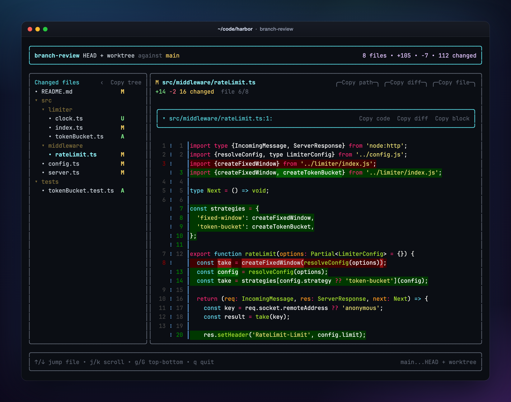
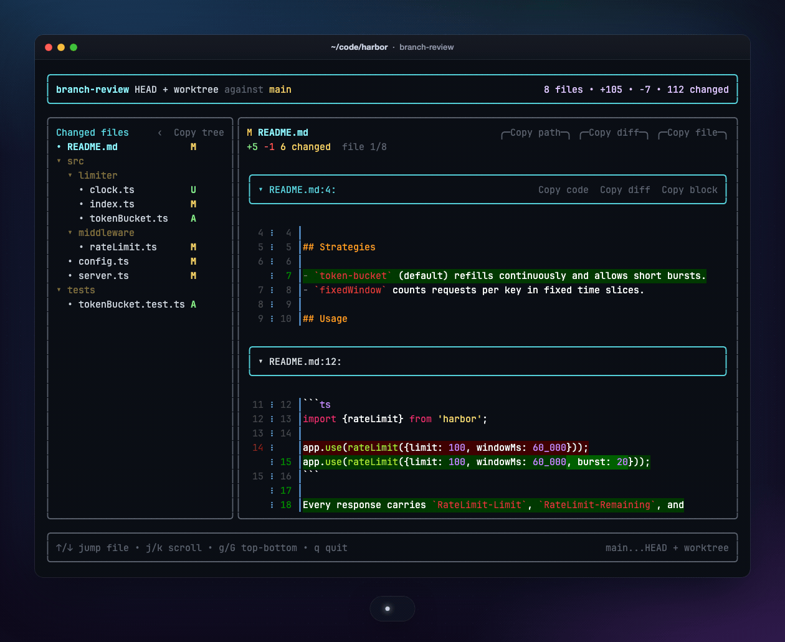
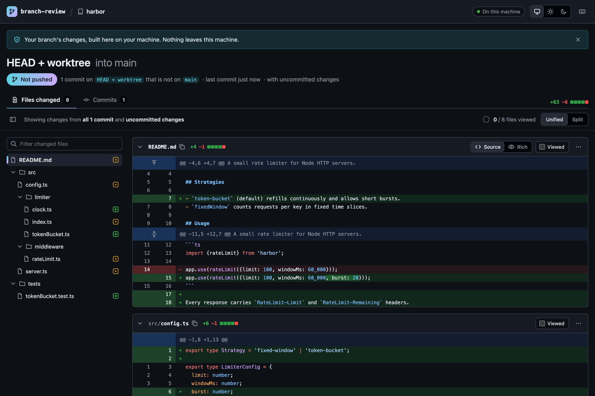

<h1 align="center">
  <picture>
    <source media="(prefers-color-scheme: dark)" srcset="assets/banner-dark.png">
    
  </picture>
</h1>

<p align="center">
  See your branch as the pull request it will become, in your terminal or your browser, before it leaves your machine.
</p>

<p align="center">
  <a href="https://github.com/hcastro/branch-review/actions/workflows/ci.yml"></a>
  <a href="LICENSE"></a>
  
  
</p>

`branch-review` shows what your branch's pull request will contain before you push: every commit since the base branch, plus everything that you haven't committed yet. Read your own changes the way a reviewer will, or keep it open beside a coding agent and watch each edit land while the agent works.

There's no AI in `branch-review`. It puts the whole change in front of you, and the reviewing is yours.

<p align="center">
  
</p>

## Install

`branch-review` needs Node.js 22 or later, Git, and [delta](https://dandavison.github.io/delta/installation.html) on your `PATH`. On macOS, install delta with Homebrew, and then install `branch-review` from npm:

```sh
brew install git-delta
npm install -g branch-review
```

Run it from any folder inside a Git repo:

```sh
branch-review
```

Copies use `pbcopy` on macOS, `clip.exe` on Windows and WSL, or `wl-copy`, `xclip`, or `xsel` on Linux. Video previews use `ffprobe` and `ffmpeg` when they're on your `PATH`.

## See the pull request before you push

With no arguments, `branch-review` detects the base branch and reviews your commits since it, along with staged, unstaged, and untracked files. That range matches the pull request that you'll open after you commit those edits.

To compare other refs, name them:

```sh
branch-review my-feature main      # my-feature vs. main
branch-review HEAD HEAD            # uncommitted changes only
```

For every argument and option, see the [reference](docs/reference.md#command).

## Watch an agent work

Leave `branch-review` open next to a coding agent. The review refreshes as files change on disk, so new files appear in the tree and edits appear in the diff you're reading, with no reload.

<p align="center">
  
</p>

Each change is highlighted as it arrives, and the review keeps your place through every refresh. Commits, checkouts, fetches, and pushes refresh it as well. For more information, see [How branch-review works](docs/how-it-works.md#watch-mode).

## Review it in the browser

To review the whole branch in a browser, press `r`. **Review in browser** opens one page laid out like a pull request on GitHub, at the file in view. To open that page at its top, press `R`.

<p align="center">
  
</p>

The page has a card for every changed file, with a file tree and a filter beside them. Diffs show unified or split, a markdown file switches to its rich view, and you can mark each file **Viewed** as you go.

To skip the terminal UI and go straight to the page, pass `--browser`:

```sh
branch-review --browser
```

To read a changed markdown file the way GitHub shows it without leaving the terminal, press `v`. **Preview** needs Ghostty, cmux, or Kitty, and a headless Chromium on disk. To list every key, press `?`.

To write the page to a directory as one self-contained `index.html`, pass `--export-html`. A later run replaces only the files that `branch-review` wrote before, and refuses to write over any other file. For more information, see [Preview and Review in browser](docs/preview-and-browser.md).

## Copy context back to the agent

When an edit needs another pass, press `b` on a diff block. **Copy block** puts the block on your clipboard with its file and line range, ready to paste into Claude Code, Codex, Cursor, or a Slack thread:

````md
File: src/server.ts
Lines: 1-8

```diff
@@ -1,7 +1,8 @@
 import {createServer} from 'node:http';
 import {rateLimit} from './middleware/rateLimit.js';
 
-const limit = rateLimit({limit: 10, windowMs: 1_000});
+const limit = rateLimit({limit: 10, windowMs: 1_000, burst: 5});
+const port = Number(process.env.PORT ?? 3000);
 
 const server = createServer((req, res) => {
   limit(req, res, () => {
```
````

Other keys copy a path, a file, a diff, or the changed-file tree. Dragging across code copies the code alone, without line numbers or diff markers. For the full list, see [Copy buttons and keys](docs/reference.md#copy-buttons-and-keys).

## See images and video in the diff

Changed PNG, JPEG, GIF, WebP, and AVIF files show as pictures in Ghostty, cmux, and Kitty, and as a block preview in other terminals with 256 colors or more. A modified image opens with its old and new versions side by side, and `3` marks the pixels that changed. A video shows its details with frames from each version.

Inside tmux, pictures need `set -g allow-passthrough all` in your tmux config. For more information about terminal support and compare modes, see [Image and video previews](docs/media-previews.md).

## Read untrusted changes safely

`branch-review` is built for reading changes that an agent or a teammate wrote, before you trust them. It doesn't write to the repo it reviews, except for pages you ask `--export-html` to write into a directory there. It also ignores repo settings that could change the diff or run a program, such as `diff.external` and textconv drivers, so the patch that you read and copy is Git's own output.

Hidden characters, such as control characters and bidirectional overrides, show on screen as markers. A line that uses them to disguise its code, the attack known as Trojan Source, stands out. For more information, see [How branch-review works](docs/how-it-works.md#hidden-characters).

## Agent skill

The repo ships an agent skill in [`skills/branch-review`](skills/branch-review) for Claude Code, or any tool that reads `SKILL.md` files. Say `let me review this`, and the agent finds the repo or worktree that holds the changes and copies a ready-to-run command to your clipboard:

```sh
cd '/Users/me/code/app' && branch-review
```

Ask to review in the browser, and the copied command ends in `--browser`. The command is written for POSIX shells and zsh, and the script refuses a repo path or ref name that holds control or invisible characters.

To install the skill from a clone, link it so it tracks your install:

```sh
mkdir -p ~/.claude/skills
ln -s "$PWD/skills/branch-review" ~/.claude/skills/branch-review
```

If you installed with `npm install -g`, link `"$(npm root -g)/branch-review/skills/branch-review"` in its place.

## Documentation

- [Reference](docs/reference.md): arguments, options, environment variables, keys, and mouse gestures
- [Clipboard copies](docs/copying.md): what each copy holds and when a copy refuses
- [Image and video previews](docs/media-previews.md): terminal support, tmux setup, and compare modes
- [Preview and Review in browser](docs/preview-and-browser.md): the review page, Preview, and `--export-html`
- [How branch-review works](docs/how-it-works.md): watch mode, refreshes, and what it touches on disk

## Development

To work on `branch-review`, build and link a clone:

```sh
git clone https://github.com/hcastro/branch-review.git
cd branch-review
pnpm install          # also builds dist/
pnpm link --global    # puts this clone's branch-review on your PATH
pnpm dev              # run from source with tsx, with no build step
pnpm test
pnpm typecheck
```

## License

MIT © hcastro

Image decoding uses [sharp](https://sharp.pixelplumbing.com/), which ships prebuilt binaries of libvips. libvips is licensed under LGPL-3.0.

The pages that Preview and Review in browser show carry a copy of [github-markdown-css](https://github.com/sindresorhus/github-markdown-css) and icons from [Octicons](https://github.com/primer/octicons), both licensed under MIT. Their license files are in `src/rendered/assets/`.
