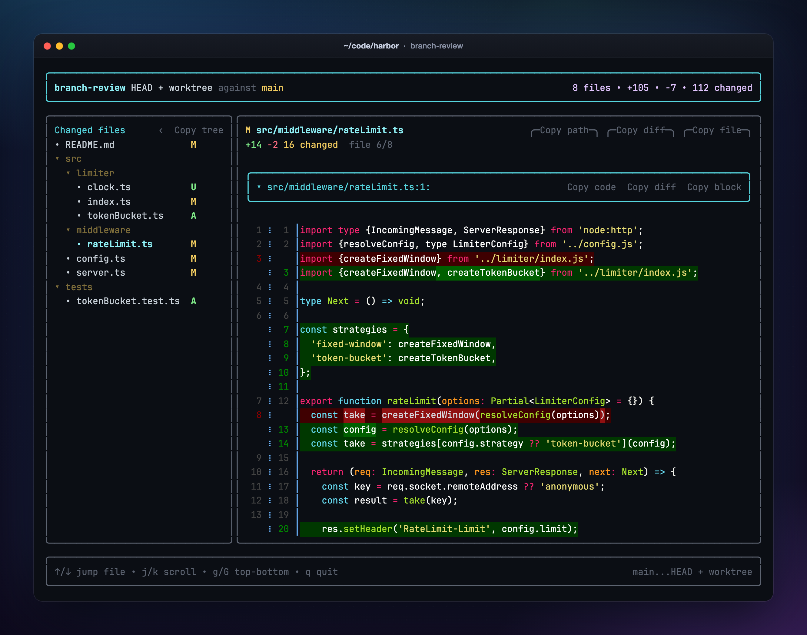
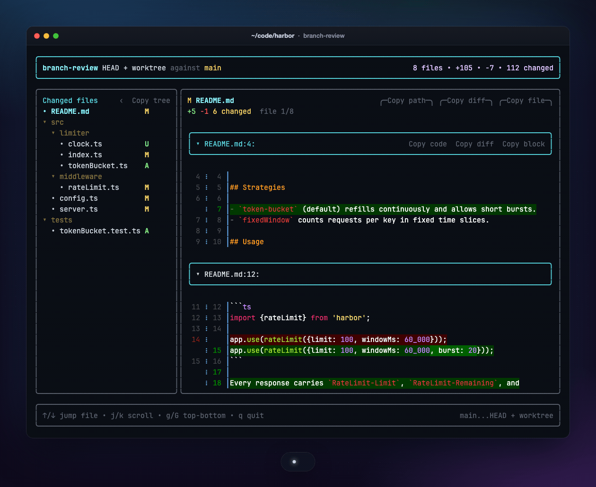

<p align="center">
  <picture>
    <source media="(prefers-color-scheme: dark)" srcset="assets/banner-dark.png">
    
  </picture>
</p>

<p align="center">
  A PR-style review UI for your terminal, built for checking what you or your coding agent changed before any of it reaches GitHub.
</p>

<p align="center">
  <a href="https://github.com/hcastro/branch-review/actions/workflows/ci.yml"></a>
  <a href="LICENSE"></a>
  
  
</p>

<p align="center">
  
</p>

Run `branch-review` in any Git repo, from the root or any folder inside it. You get a changed-file tree, syntax-highlighted diffs from [`git-delta`](https://github.com/dandavison/delta), and per-file and branch-wide stats. The view updates live while files change on disk.

Every file and diff block has copy buttons. They hand a path, a diff, or an agent-ready block of context to Claude Code, Codex, Cursor, or a Slack thread in one click.

## Watch an agent work

Leave `branch-review` open next to a coding agent. New files land in the tree as they're written. Edits wash in over the diff you're reading, and you never reload.

<p align="center">
  
</p>

By default the review covers `HEAD` plus your worktree against the base branch. Commits the agent made and edits it hasn't committed yet show up together, scoped the way the eventual PR will be.

## Install

You need Node.js 22+, Git, and `git-delta` on your `PATH`. CI runs on Node 22 and 24.

```sh
brew install git-delta          # macOS. See the delta docs for other platforms.
```

Install the CLI straight from GitHub. The package builds itself on install, so pnpm needs permission to run that build:

```sh
pnpm add -g --allow-build=branch-review github:hcastro/branch-review
```

Or work from a clone:

```sh
git clone https://github.com/hcastro/branch-review.git
cd branch-review
pnpm install
pnpm link --global
```

## Usage

```sh
branch-review                      # HEAD + worktree vs the detected base
branch-review my-feature           # my-feature vs the detected base
branch-review my-feature main      # my-feature vs main
branch-review HEAD HEAD            # uncommitted changes only
```

From a subdirectory, the review still covers the whole repo, with paths relative to the repo root.

The base comes from `origin/HEAD` when the remote has one. Otherwise it falls back to the first of `development`, `main`, `master`, and `trunk` that exists.

Refs resolve locally first and then as `origin/<ref>`. That lets you review against a remote base you never checked out:

```sh
branch-review my-feature release/2026.04
```

### Options

| Flag | Effect |
| --- | --- |
| `--watch` | Refresh live as files change. On by default in an interactive terminal. |
| `--no-watch` | Open a frozen snapshot. Handy while an agent is mid-write and the view would churn. |
| `--watch-poll` | Poll instead of using filesystem events. Use it on network mounts and container bind mounts. |
| `--no-animations` | Skip the arrival highlights. Useful on slow or remote terminals. |

Colour is off when `NO_COLOR` is set to any non-empty value, when `FORCE_COLOR` is `0` or `false`, or when `TERM=dumb`. The same rule covers delta's diffs and the app's own chrome. Diffs keep their `+` and `-` markers.

## Reviewing

### Keys

| Key | Action |
| --- | --- |
| `↑` / `↓` | Previous / next file |
| `j` / `k` | Scroll the diff down / up |
| `g` / `G` | Jump to the top / bottom |
| `[` / `]` | Previous / next diff block |
| `Enter` / `Space` | Collapse or expand the focused block |
| `t` | Show or hide the file tree |
| `q` / `Esc` / `Ctrl-C` | Quit |

The focused block is the one at the top of the diff pane, and it's marked. The footer keeps a short hint of these keys.

Every copy action works from the keyboard too. File keys copy from the current file, and block keys copy from the focused block.

| Key | Copies |
| --- | --- |
| `y` | Path relative to the repo root |
| `Y` | Absolute path |
| `d` | The file's diff |
| `f` | The file's current contents |
| `c` | The block's code |
| `p` | The block's diff |
| `b` | The block as agent-ready context |
| `T` | The changed-file tree |

### Mouse

| Gesture | Action |
| --- | --- |
| Click a file | Jump the diff to that file |
| Click a folder | Collapse or expand it |
| Click a block header | Collapse or expand that diff block |
| Drag across code | Select lines and copy them |
| Drag the tree's edge | Resize the file tree. `‹` collapses it. |
| Scroll | Scroll whichever pane is under the pointer |

### Copy actions

Hover a file header, a diff block, or a tree row to reveal its copy buttons.

| Where | Button | Copies |
| --- | --- | --- |
| File header | `Copy path` | Path relative to the repo root |
| | `Copy absolute path` | Full path on disk. It shows up when you hover `Copy path`. |
| | `Copy diff` | The file's diff |
| | `Copy file` | The file's current contents |
| Diff block | `Copy code` | The block's added lines, without diff markers |
| | `Copy diff` | The block's diff |
| | `Copy block` | Agent-ready context for the block |
| Tree row | `Copy` | That file's path |
| Tree header | `Copy tree` | The changed files as a fenced ASCII tree |

`Copy block` produces a snippet you can paste straight into a prompt:

````md
File: src/server.ts
Lines: 1-8

```diff
@@ -1,7 +1,8 @@
 import {createServer} from 'node:http';
 import {rateLimit} from './middleware/rateLimit.js';
 
-const limit = rateLimit({limit: 10, windowMs: 1_000});
+const limit = rateLimit({limit: 10, windowMs: 1_000, burst: 5});
+const port = Number(process.env.PORT ?? 3000);
 
 const server = createServer((req, res) => {
   limit(req, res, () => {
```
````

When Git can name the enclosing function, the snippet adds a `Function:` line too.

Copies keep the file's exact bytes, from the buttons, the keys, and a drag-select alike. Tabs stay tabs and control characters stay as they are, even though the screen shows them as visible markers.

Some copies fail on purpose, and the toast names the reason:

- A file that isn't valid UTF-8 text can't be copied as text. The copy reports "not UTF-8 text".
- Copying contents (`Copy file` or `f`) fails for a file over 16 MB.
- When a file's diff failed to load, its diff and block copies report that failure as the reason. `Copy file` and `f` still work, since they read the file itself.
- A file whose name isn't valid UTF-8 can't be copied at all, its path included. Every copy of it reports "file name is not UTF-8".
- `Copy tree` and `T` copy nothing when any one file name in the review isn't valid UTF-8. The tree is refused whole, and the toast names that file.

### Small terminals

When the terminal is too narrow for both panes, the file tree collapses to a narrow rail beside the diff. Below a minimum size, the app shows "Terminal too small" until you make the window bigger. While it does, only `q`, `Esc` and `Ctrl-C` do anything.

## Agent skill

The repo ships an agent skill in [`skills/branch-review`](skills/branch-review). It teaches Claude Code, or any tool that reads `SKILL.md`, to hand you a ready-to-run `branch-review` command.

An agent can't drive a full-screen TUI, so the skill never runs the CLI itself. It works out which repo or worktree holds the changes, picks the refs, and copies one line to your clipboard:

```sh
cd '/Users/me/code/app' && branch-review
```

Ask for it with "let me review this", "/branch-review", or "show me the diff before you continue". Paste, review, and quit with `q`.

The command is written for POSIX shells and zsh. The script refuses a repo path or ref name that holds control or invisible characters, such as a newline, an escape, or a bidi control, because a pasted command can't carry those safely. Its own report shows them escaped, like `\x1b` or `\u202e`.

Link the skill into your user skills directory so it tracks the repo:

```sh
ln -s "$PWD/skills/branch-review" ~/.claude/skills/branch-review
```

To pin a version, copy it with `cp -R` instead. For one project only, put it in that repo's `.claude/skills/`.

## How it works

`branch-review` asks Git for the changed files in the range, pipes each file's diff through `delta` with a fixed theme, and lays out the result with [Ink](https://github.com/vadimdemedes/ink). Untracked files are diffed against `/dev/null`, so new files show up before anyone stages them.

Watch mode follows the work tree plus the Git state that moves on a commit, push, or fetch: `HEAD`, the index, the current branch ref, and remote refs. On macOS and Windows it uses one native recursive watch on the repo root. On Linux it watches directories only, so the number of handles grows with directories and never with files. Either way it skips what Git ignores, never follows symlinks, and doesn't descend into submodules or nested repos. `--watch-poll` is the fallback when filesystem events don't arrive.

A cheap fingerprint decides whether anything changed. When it did, a background process rebuilds the review so the UI stays responsive while delta runs. Each file it finishes counts as progress, and so does each chunk of output from `git` or `delta`. The process is stopped only when `git` or `delta` produces nothing for 30 seconds. A slow refresh of a large repo finishes, and a hung `git` or `delta` still gets killed.

### What branch-review touches

`branch-review` never writes to the repo it reviews. It leaves the index, the work tree, refs, the stash, config, and hooks alone. Worktree diffs read a private copy of the index with Git's optional locks off, so a stat-dirty file never makes Git rewrite `.git/index` or a submodule's index.

A few things happen the same way they do for `git status` or `git diff`:

- Configured clean filters such as git-lfs run on worktree files, and git-lfs may store objects under `.git/lfs`.
- In a split-index repo, Git refreshes the shared index file's mtime on every read. Its content stays the same.
- A partial clone may fetch missing objects on demand, and Git writes what it fetches into `.git/objects` as new pack files. Git is never allowed to prompt, so a fetch that needs credentials shows up as an error on that file.

## Development

```sh
pnpm install      # also builds dist/
pnpm dev          # run from source with tsx, watch mode included
pnpm test
pnpm typecheck
pnpm build
```

## License

MIT © hcastro
