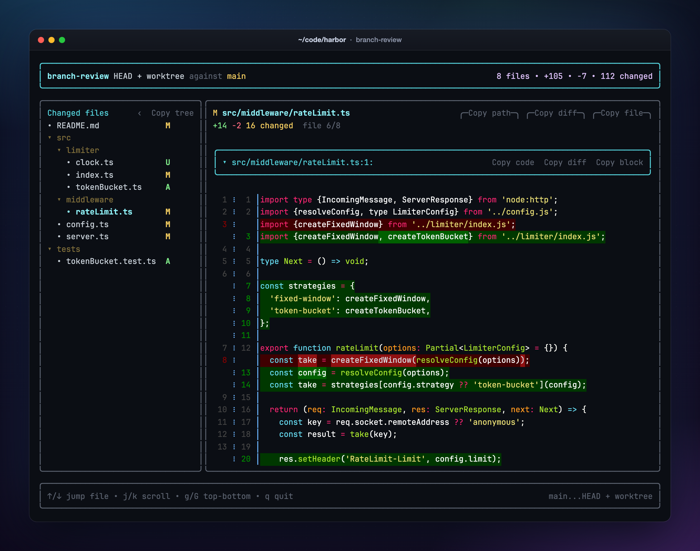
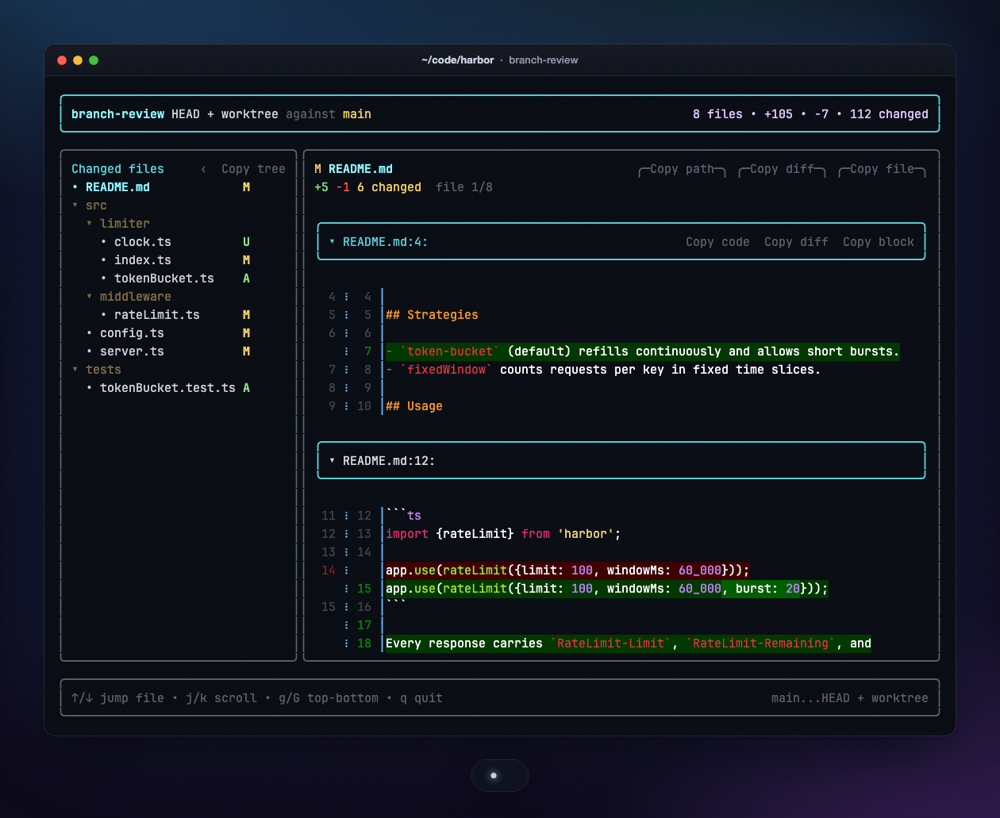

<h1 align="center">
  <picture>
    <source media="(prefers-color-scheme: dark)" srcset="assets/banner-dark.png">
    
  </picture>
</h1>

<p align="center">
  A PR-style review UI in your terminal for checking what you or a coding agent changed before it reaches GitHub.
</p>

<p align="center">
  <a href="https://github.com/hcastro/branch-review/actions/workflows/ci.yml"></a>
  <a href="LICENSE"></a>
  
  
</p>

`branch-review` shows what your branch's pull request will contain, in the terminal, before you push. Use it to read your own changes the way a reviewer will, or keep it open beside a coding agent and watch each edit land while the agent works.

When an edit needs another pass, copy the block or its path into the agent's prompt. Changed images and videos show as pictures in the diff. `branch-review` never writes to the repo or runs its diff settings, so you can read a change from an agent or a teammate before you trust it.

In the following screenshot, a rate-limiting change is under review, with the changed-file tree beside the diff of `src/middleware/rateLimit.ts`:

<p align="center">
  
</p>

In the preceding screenshot, the tree lists eight changed files, each with a colored status letter such as `A` for added, `M` for modified, or `U` for untracked. Each diff comes from delta, with syntax highlighting and line numbers, and the top bar shows the totals for the whole branch.

## Review what the pull request will contain

Run `branch-review` from the root of a Git repo or from any folder inside it. By default, it reviews the commits on your branch since it left the base branch, plus everything that you haven't committed. That includes staged and unstaged edits and untracked files that nobody has staged yet. The top bar labels this range `HEAD + worktree`, and it matches the pull request that you'll open after you commit those edits.

You don't have to name the base, because `branch-review` detects it. For more information about how it picks the base and about other comparisons, see the [Usage](#usage) section.

A renamed file shows its edits against its old path. A change with no text to diff still shows up in the review. A pure rename, a mode change, a new empty file, or a binary file gets a one-line summary, such as `renamed from a.txt` or `mode 100644 → 100755`.

A file that can't be diffed shows `✗ Could not load diff` and the reason under its header, and the rest of the review keeps working.

## Watch an agent work

Leave `branch-review` open next to a coding agent. The review refreshes as files change on disk, so new files appear in the tree as the agent writes them and edits appear in the diff you're reading, with no reload.

The following recording shows an agent writing a new file and then editing it while `branch-review` is open:

<p align="center">
  
</p>

Each change is highlighted as it arrives. In a truecolor terminal, a new file or block is tinted green and an edited one teal, and the tint fades within about a second and a half. The file's tree row stays lit in a matching color for about 2.6 seconds.

The review keeps your place through every refresh: the text at the top of the pane stays in place when lines or files appear above it. Blocks that you collapsed stay collapsed, and a block that you focused with `[` or `]` keeps its focus as long as its header doesn't move. If the lines you're selecting change mid-drag, `branch-review` drops the selection and says why, so the copy never holds text that you didn't pick.

Commits, checkouts, fetches, and pushes refresh the review as well, and `branch-review` recalculates the range each time. The footer shows `refreshing...` and then `updated now`. If a refresh fails, the last good review stays on screen with Git's reason in the footer, and the next change tries again.

## Copy context back to the agent

Every file and diff block has copy buttons, and most buttons have a key. They put a diff or a block of agent-ready context on your clipboard, ready to paste into Claude Code, Codex, Cursor, or a Slack thread.

**Copy block**, or `b`, copies the focused block as a snippet that you can paste into a prompt. The following example shows a block copied from `src/server.ts`:

````md
File: src/server.ts
Lines: 1-8

```diff
@@ -1,7 +1,8 @@
 import {createServer} from 'node:http';
 import {rateLimit} from './middleware/rateLimit.js';
 
-const limit = rateLimit({limit: 10, windowMs: 1_000});
+const limit = rateLimit({limit: 10, windowMs: 1_000, burst: 5});
+const port = Number(process.env.PORT ?? 3000);
 
 const server = createServer((req, res) => {
   limit(req, res, () => {
```
````

When Git can name the enclosing function, the snippet adds a `Function:` line too. The fence is longer than any run of backticks in the patch, so no line of code can close it early, and the patch keeps its trailing context lines so it still applies.

Dragging across code copies the code alone, without delta's line numbers or the `+` and `-` markers. Every copy keeps the file's exact bytes, including a drag-select. A wrapped line copies as one line with its tabs intact, and a control character that the screen shows as a marker copies as the real character.

File keys copy from the file at the top of the diff, and block keys copy from the focused block. The following table lists every copy:

| Where | Button | Key | Copies |
| --- | --- | --- | --- |
| File header | **Copy path** | `y` | The path relative to the repo root |
| File header | **Copy absolute path** | `Y` | The full path on disk. The button appears when you hold the pointer over **Copy path**. |
| File header | **Copy diff** | `d` | The file's diff |
| File header | **Copy file** | `f` | The file's contents in the reviewed version: the file on disk by default, or the branch's version when you review a named branch |
| Diff block | **Copy code** | `c` | The block's added lines, without diff markers |
| Diff block | **Copy diff** | `p` | The block's diff |
| Diff block | **Copy block** | `b` | The block as agent-ready context |
| Tree row | **Copy** | None | That file's path |
| Tree header | **Copy tree** | `T` | The changed files as a fenced ASCII tree |

A file header always shows its buttons. A diff block shows its buttons when it's focused or when you hold the pointer over it, and a tree row shows **Copy** while the pointer is over the row. After a copy, the button reads **✓ Copied** for a moment, and the footer names what you copied, such as `✓ Copied block · src/a.ts:12`.

Some copies refuse on purpose, and the footer names the reason. A file that isn't UTF-8 text, for example, reports `not UTF-8 text`. For more information about refusals and payload formats, see [Clipboard copies in branch-review](docs/copying.md).

## See images and video in the diff

Added, deleted, and modified PNG, JPEG, GIF, WebP, and AVIF files show as pictures in Ghostty, cmux, and Kitty. Other terminals with 256 colors or more draw a block preview in colored half-block characters. Kitty and Ghostty 1.4 or later play an animated GIF or WebP in a loop. Inside tmux, pictures need `set -g allow-passthrough all` in your tmux config.

A modified image opens with its old and new versions side by side. To flip between the versions, press `2`. The difference view, on `3`, marks changed pixels over a darkened copy and shows what percent of the image changed. An SVG shows its rendered picture with its source collapsed under it. A video shows a table of its length, size, resolution, codec, and frame rate, with frames taken from each version.

For more information about terminal support, tmux setup, compare modes, and opening a file in a viewer, see [Image and video previews](docs/media-previews.md).

## Preview markdown and review it in the browser

To read a changed markdown file the way GitHub shows it, press `v`, and **Preview** draws its page right in the review, with a bar in the margin beside each block the branch added or changed. To review the whole branch in a browser, press `r`, and **Review in browser** opens one page laid out like a pull request on GitHub, at the card of the file in view, in a browser split beside the review in cmux, or in your default browser in other terminals. To open that page at its top, press `R` for **All files in browser**. To list every key, press `?`.

The first time a file can use them, the footer says so in one line, such as `Tip: press v to preview this file as GitHub shows it, or r to open its changes in the browser`. The file header has the same actions as buttons: **Preview**, which reads **Diff** while the Preview shows, and **Review in browser ⇗**.

Preview needs Ghostty, cmux, or Kitty, and a headless Chromium already on disk. Where either is missing, the footer leaves `v` out, and `r` still works. When Preview can't draw a page, the diff comes back where you were reading, and the footer says why. To turn Preview off, set `BRANCH_REVIEW_PREVIEW=off`.

The page has a card for every changed file, in the review's order, with a file tree and a filter beside them. A code file's card shows its diff with GitHub's syntax colors and word highlights, unified or split, and expands the unchanged lines around each hunk. A markdown file's card switches between its diff and its rich view, the file as GitHub draws it with each added or changed block marked. An image's card compares its versions in 2-up, swipe, and onion skin. A binary file, a submodule, a Git LFS file, or a rename with no changes gets one line in its card, as on GitHub, and a diff over 3,000 lines waits behind **Load diff**. Mark a file **Viewed** to fold it, and the browser remembers it for this review. The **Commits** tab lists the branch's commits, and the title says whether the branch is pushed, ahead, or behind. A list at the top names each link that won't resolve on GitHub, such as one to a missing file or heading. In watch mode, an open split follows your edits, keeps your place and your viewed marks, and pulses the cards that changed. The page fits a phone's width, with the file tree behind its **Files** button.

To write the page for the whole branch to a directory without opening the UI, pass `--export-html`:

```sh
branch-review --export-html ../pages
```

Pick a directory outside the repo. A page written inside it shows up as an untracked file in the next review.

The directory gets the page as `index.html`, one HTML file whose only scripts are its own. Images from the repo travel inside it, and nothing on it loads from the network. It also gets `links.json`, which lists every link with what it resolves to. A later run replaces only an `index.html` and a `links.json` that `branch-review` wrote before, and refuses to write over any other file. To get a report that an agent or a CI job can read, add `--json`. For more information about where pages open, the marks, Preview, how close a page is to GitHub, and the report, see [Preview and Review in browser](docs/preview-and-browser.md).

## Review untrusted changes safely

`branch-review` is built for reading changes that an agent or a teammate wrote, before you trust them. It doesn't write to the repo it reviews, except for pages you ask `--export-html` to write into a directory there. The index, the working tree, refs, the stash, config, and hooks stay as they were, and Git runs on a private copy of the index.

`branch-review` ignores repo settings that could change the diff or run a program, such as `diff.external`, textconv drivers, `core.fsmonitor`, and `diff.noprefix`. The patch that you read and copy is Git's own output.

Hidden characters, such as control characters and bidirectional (bidi) overrides, show on screen as markers, for example `^M` or `<U+202E>`, in diffs, paths, ref names, and tooltips. A line that uses bidi characters to disguise its code, the attack known as Trojan Source, stands out on screen, and so does a look-alike file name. Copies keep the original bytes.

For more information about watch mode and what `branch-review` touches on disk, see [How branch-review works](docs/how-it-works.md).

## Install

You need the following tools:

- Node.js 22 or later. CI runs on Node 22 and 24.
- Git.
- A clipboard tool for copies: `pbcopy` on macOS, `clip.exe` on Windows and WSL, or `wl-copy`, `xclip`, or `xsel` on Linux.
- Optional: `ffprobe` and `ffmpeg` on your `PATH`, for video metadata and frames.

To install `branch-review`, follow these steps:

1. Install delta (the `git-delta` package), with its `delta` command on your `PATH`. On macOS, install it with Homebrew:

   ```sh
   brew install git-delta
   ```

   For other platforms, see the [delta installation instructions](https://dandavison.github.io/delta/installation.html).

2. Install `branch-review` from GitHub:

   ```sh
   pnpm add -g --allow-build=branch-review github:hcastro/branch-review
   ```

   The package builds when it installs, so the `--allow-build` flag lets pnpm run that build.

To install from a clone instead, link the package globally:

```sh
git clone https://github.com/hcastro/branch-review.git
cd branch-review
pnpm install
pnpm link --global
```

## Usage

The command takes up to two refs:

```
branch-review [BRANCH [BASE]] [OPTIONS]
```

Replace the following:

- `BRANCH`: the branch to review. The default is `HEAD`, which also includes uncommitted and untracked files. Any other branch is reviewed by its commits only.
- `BASE`: the branch to compare against. The default is the detected base.

The following examples show common comparisons:

```sh
branch-review                      # HEAD plus the working tree vs. the detected base
branch-review my-feature           # my-feature's commits vs. the detected base
branch-review my-feature main      # my-feature vs. main
branch-review HEAD HEAD            # uncommitted changes only
```

From a subdirectory, the review still covers the whole repo, with paths relative to the repo root. Outside a repo, `branch-review` exits with a one-line `not a git repository` error.

The detected base is `origin/HEAD` when the remote has one. Otherwise, `branch-review` uses the first of `development`, `main`, `master`, and `trunk` that exists, locally or on `origin`. If none of those exists, it uses the current branch, which leaves only uncommitted changes in the review. A repo where nothing resolves makes it exit and ask for a base, such as `branch-review HEAD main`.

Refs resolve locally first and then on `origin`, so you can review against a remote base that you never checked out:

```sh
branch-review my-feature release/2026.04
```

### Options

`branch-review` accepts the following options:

| Flag | Effect |
| --- | --- |
| `--watch` | Refresh live as files change. On by default in an interactive terminal. |
| `--no-watch` | Open a snapshot that doesn't refresh, for when an agent is mid-write and the view keeps changing. It overrides `--watch` and `--watch-poll`. |
| `--watch-poll` | Turn on watch mode, and poll for changes in place of filesystem events. Use it on network mounts and container bind mounts. |
| `--no-animations` | Skip the arrival highlights, the sweep toward a page in the browser, the page's glow on the card it opens at and its pulse on a live refresh, and Preview's arrival, and show an animated GIF or WebP as its first frame. Use it on slow or remote terminals. |
| `--animations` | Turn animations back on after an earlier `--no-animations`. |
| `--no-images` | Show image, SVG, and video files as plain diffs. |
| `--images` | Turn previews back on after an earlier `--no-images`. `BRANCH_REVIEW_IMAGES=off` and `NO_COLOR` still turn them off. |
| `--export-html DIR` | Write the review page for the whole branch to `DIR` as `index.html`, with `links.json`. Then print a summary and exit without opening the UI. |
| `--json` | With `--export-html`, print the report as JSON. |

For `--animations` and `--images`, the last flag of each pair wins.

### Environment variables

`branch-review` reads the following environment variables:

| Variable | Effect |
| --- | --- |
| `NO_COLOR` | Any non-empty value turns off color and image previews. |
| `FORCE_COLOR` | `0` or `false` turns off color and image previews. |
| `TERM` | `dumb` turns off color and image previews. `linux`, and `screen*` outside tmux, turn off image previews. |
| `BRANCH_REVIEW_IMAGES` | `auto`, the default, detects what the terminal can draw. `kitty` forces pictures in a terminal that supports them but isn't recognized. `blocks` forces the block preview. `off`, `none`, `0`, or `false` turns previews off. |
| `BRANCH_REVIEW_MOTION` | `full`, `reduce`, or `off` sets the motion of Preview and on the way to a page in the browser, in place of the macOS **Reduce motion** setting. |
| `BRANCH_REVIEW_PREVIEW` | `off`, `0`, `false`, or `none` turns Preview off, the page a markdown file shows in the review on `v`, in a terminal that draws Kitty images. `on`, like any other value, leaves it on. |
| `BRANCH_REVIEW_CHROME` | The absolute path of the headless Chromium or Chrome that Preview draws pages with, in place of the one `branch-review` finds on disk. |
| `BRANCH_REVIEW_PREVIEW_DPR` | A fixed scale for Preview's pages, such as `2`, in place of the one that makes their text as tall as the terminal's. For comparing the two. |
| `BRANCH_REVIEW_TMPDIR` | The directory for temp files, such as the private index copy and media files. The default is the system temp directory. |

The same settings turn off color in delta's diffs and in the rest of `branch-review`. With color off, diffs keep their `+` and `-` markers, and a selection shows in inverse video.

## Keys and mouse

The following table lists the keys for moving through a review:

| Key | Action |
| --- | --- |
| `↑` / `↓` | Jump to the previous or next file |
| `j` / `k` | Scroll the diff down or up one line |
| `g` / `G` | Jump to the top or bottom |
| `[` / `]` | Focus the previous or next diff block |
| `Enter` / `Space` | Collapse or expand the focused block |
| `t` | Show or hide the file tree |
| `v` | Preview: on a markdown file, in a terminal that draws Kitty images, show the file as GitHub shows it, in place of its diff, and back. In a Preview, `[` and `]` move between changes and `c` copies the markdown of the block at the top. |
| `r` | Review in browser: open the branch's changes as one page in a browser split or your browser, at the file in view |
| `R` | All files in browser: open the branch's page at its top |
| `?` | List every key, in a review with a file to preview or open. `Esc` or `?` closes the list. |
| `q` / `Esc` / `Control+C` | Quit |

The tree highlights the file at the top of the diff and keeps that row in view as you scroll. That file's header shows its added, deleted, and changed line counts and its place in the review, such as `file 6/8`. Each block header names the file and the block's first line, such as `src/middleware/rateLimit.ts:1:`.

The focused block is the one at the top of the diff pane until you move the focus with `[` or `]`. Heavy `┃` bars mark its header, so the mark reads without color. The footer keeps a short hint of the keys that apply to the file in view. For more information about the copy keys, see the [Copy context back to the agent](#copy-context-back-to-the-agent) section.

While an image or video preview is on screen, the following keys work:

| Key | Action |
| --- | --- |
| `1` / `2` / `3` | Compare a modified image side by side, by flipping between its versions, or as a difference. `2` again flips to the other version. On a video, `1` shows both frame strips and `2` shows one. |
| `v` | Switch an image or video to a details table and back. On an SVG, show its source only, and back. |
| `o` | Open the image or video in the default viewer |
| `O` | Preview the image or video in Quick Look on macOS. On Linux and BSD, `O` works like `o`. |

You can also do most of this with the mouse:

| Gesture | Action |
| --- | --- |
| Click a file | Jump the diff to that file |
| Click a folder | Collapse or expand it |
| Click a block header | Collapse or expand that diff block |
| Click **Preview** in a file header | Show the file's Preview, like `v` |
| Click **Diff** in a file header | Go back from the Preview to the diff, like `v` |
| Click **Review in browser ⇗** in a file header | Open the branch's page in the browser at that file, like `r` |
| Click a link in a Preview | Scroll to a heading on the page, open another file of the review, or copy a web address |
| Drag across code | Select lines and copy them |
| Drag the tree's right border | Resize the file tree. Dragging it to its minimum width collapses it to a rail. |
| Click `‹` or `›` in the tree header | Collapse or expand the file tree |
| Scroll | Scroll whichever pane is under the pointer, three lines per notch |

To see what a button, badge, or label does, hold the pointer over it. A short hint appears in the top bar, such as `copies block with file and line context`.

The branch's page in the browser has keys of its own, which work after you click into the page:

| Key | Action |
| --- | --- |
| `j` / `k` | Scroll to the next or previous file's card |
| `v` | Mark the current file as viewed and move to the next, or unmark it |
| `?` | Show the page's keys |
| `Esc` | Close the keys, a menu, or the file list |

A page that `--export-html` writes has the same keys.

### Small terminals

When the terminal is narrower than 74 columns, the file tree collapses to a rail beside the diff, and it opens again after the window is wide enough. Below 58 columns by 14 rows, `branch-review` shows `Terminal too small` with the current and required size. Until you make the window bigger, only `q`, `Esc`, and `Control+C` work.

## Agent skill

The repo ships an agent skill in [`skills/branch-review`](skills/branch-review). It teaches Claude Code, or any tool that reads `SKILL.md` files, to hand you a ready-to-run `branch-review` command.

An agent can't drive a full-screen terminal UI, so the skill never opens the UI itself. It finds the repo or worktree that holds the changes and picks the refs. Then it copies one line to your clipboard, such as the following:

```sh
cd '/Users/me/code/app' && branch-review
```

To get the command, ask the agent with a phrase such as `let me review this`, `/branch-review`, or `let me check the diff before you continue`. Paste the command into your terminal. When you finish the review, press `q`. To get a frozen snapshot or another option, say so, and the skill puts the flag, such as `--no-watch`, in the copied command. To get the review as an HTML file instead, ask for it, such as `export the review as HTML`. The agent runs `branch-review --export-html` itself, since that run writes the page and exits, and replies with the page's path.

The command is written for POSIX shells and zsh. The script refuses a repo path or ref name that holds control or invisible characters, because a pasted command can't carry them safely. Examples include a newline, an escape, and a bidi control, and the script's report shows them escaped, such as `\x1b` or `\u202e`.

### Install the skill

From the root of a clone, link the skill so it tracks your install:

```sh
mkdir -p ~/.claude/skills
ln -s "$PWD/skills/branch-review" ~/.claude/skills/branch-review
```

If you installed with `pnpm add -g`, link the copy inside the global package:

```sh
mkdir -p ~/.claude/skills
ln -s "$(pnpm root -g)/branch-review/skills/branch-review" ~/.claude/skills/branch-review
```

To pin a version, copy the folder with `cp -R` in place of the link. For one project only, put it in that repo's `.claude/skills/` folder.

## Development

The package scripts build and test a clone:

```sh
pnpm install      # also builds dist/
pnpm dev          # run from source with tsx, with no build step
pnpm test
pnpm typecheck
pnpm build
```

## License

MIT © hcastro

Image decoding uses [sharp](https://sharp.pixelplumbing.com/), which ships prebuilt binaries of libvips. libvips is licensed under LGPL-3.0.

The pages that Preview and Review in browser show carry a copy of [github-markdown-css](https://github.com/sindresorhus/github-markdown-css) and icons from [Octicons](https://github.com/primer/octicons), both licensed under MIT. Their license files are in `src/rendered/assets/`.
